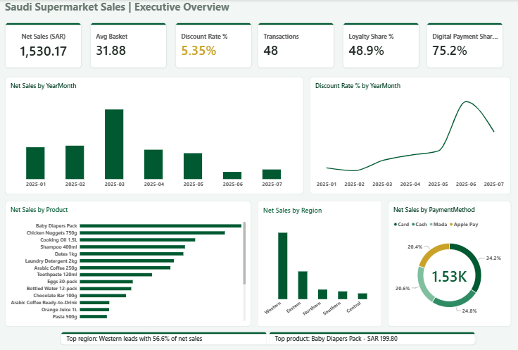
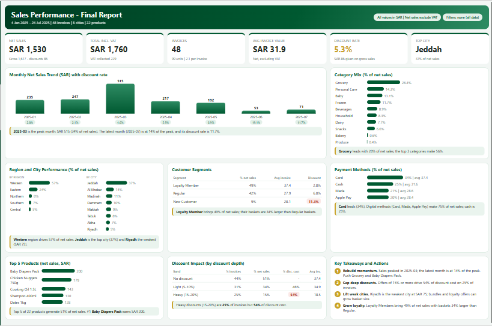

[English](README.md) | **العربية**

# مبيعات السوبرماركت السعودي: لوحة Power BI

لوحة تنفيذية في Power BI على عيّنة من معاملات سوبرماركت سعودي (48 صفاً، يناير–يوليو 2025، بالريال السعودي). تتكوّن من صفحتين: **Executive Overview** (عناصر Power BI الأصلية) و**HTML Report** التفاعلية (مولَّدة بـ DAX ومعها استنتاجات مكتوبة).

**صفحة HTML Report التفاعلية** (تُعاد حساباتها مع كل سلايسر):

## الأرقام الرئيسية

| المؤشر | القيمة |
|---|---|
| صافي المبيعات | 1,530.17 ريال |
| متوسط السلة | 31.88 ريال |
| معدل الخصم | 5.35% (كهرماني) |
| عدد المعاملات | 48 |
| حصة الولاء | 48.9% |
| حصة الدفع الرقمي | 75.2% |

تستحوذ المنطقة الغربية على 56.6% من صافي المبيعات، وبلغ الخصم ذروته في يونيو بنسبة 19.1% من إجمالي المبيعات.

## محتويات المشروع

- **6 بطاقات مؤشرات** بألوان الحالة: معدل الخصم أخضر حتى 5%، كهرماني من 5% إلى 8%، أحمر فوق 8%، ويُحرَّك بمقياس DAX واحد.
- **32 مقياس DAX** مرتّبة في مجلدات عرض (Sales وBasket وDiscounts وTime وCustomers وProducts وFormatting).
- **5 رسوم:** صافي المبيعات حسب الشهر، ومعدل الخصم حسب الشهر، وصافي المبيعات حسب المنتج والمنطقة وطريقة الدفع.
- **تصفية متقاطعة كاملة** بين سلايسرات المنطقة والمدينة والفئة وشريحة العميل وبين الرسوم.
- **سطور استنتاج ديناميكية** (أعلى منطقة، أعلى منتج) تتغير مع كل فلتر.
- **ثيم JSON مخصص** مطبَّق على كل العناصر.
- **صفحة HTML Report التفاعلية**، مبنية بالكامل بمقاييس DAX (يعرض المكوّن البصري HTML Content مقياساً واحداً هو `Report HTML`). تضم:
  - 6 بطاقات مؤشرات، منها الضريبة وأعلى مدينة.
  - اتجاه شهري مع نسبة الخصم لكل شهر.
  - توزيع الفئات، وأداء المناطق والمدن، وشرائح العملاء، وطرق الدفع، وأفضل المنتجات.
  - جدول أثر الخصم حسب عمق الخصم.
  - أربع توصيات تنفيذية.
  
  وتحمل كل بطاقة استنتاجاً مكتوباً يُعاد حسابه مع السلايسرات المتزامنة بين الصفحتين.

## هيكل المستودع

| المجلد | المحتوى |
|---|---|
| `dax/` | المقاييس الأساسية (`Saudi_Supermarket_Measures.dax`) و13 مقياس صفحة HTML (`Saudi_Supermarket_HTML_Blocks.dax`) |
| `theme/` | ثيم Power BI (JSON) |
| `data/` | عيّنة البيانات (xlsx) |
| `docs/` | صور اللوحة للصفحتين، مواصفات الاستنتاجات، كاروسيل LinkedIn (PDF) |

## نموذج البيانات

- `Saudi_Supermarket_Sales`: جدول الحقائق، صف لكل معاملة (48 صفاً).
- `Dim Date`: جدول التاريخ، مرتبط بجدول الحقائق على `Date` (متعدد إلى واحد).

## طريقة إعادة البناء

1. افتح Power BI Desktop وحمّل `data/Saudi_Supermarket_Sales_SalesData.xlsx` (الورقة `SalesData`).
2. أنشئ `Dim Date` (CALENDAR على مدى البيانات) واربطه بجدول الحقائق على `Date`.
3. افتح **DAX query view** والصق محتوى `dax/Saudi_Supermarket_Measures.dax` ثم اضغط **Update model with changes**.
4. استورد الثيم: **View ← Themes ← Browse for themes** واختر `theme/Saudi_Supermarket_Theme_v2.json`.
5. ابنِ العناصر: 6 بطاقات (`Net Sales` و`Avg Basket` و`Discount Rate %` و`Transactions` و`Loyalty Share %` و`Digital Payment Share %`) والرسوم الخمسة، ثم أضف السلايسرات الأربعة.
6. لصفحة HTML Report: ثبّت المكوّن البصري **HTML Content**، وشغّل `dax/Saudi_Supermarket_HTML_Blocks.dax` في DAX query view (**Update model with changes**)، وضع المقياس `Report HTML` في خانة Values. انسخ السلايسرات الأربعة إلى الصفحة مع تفعيل **Sync slicers**.
7. لبطاقة معدل الخصم: **Format ← Callout value ← Color ← fx ← Field value ← `Discount Status Color`**.

## أسئلة الأعمال التي تجيب عنها اللوحة

- أي المناطق والمنتجات تقود صافي المبيعات؟
- هل مستوى الخصم صحي، ومتى ارتفع؟
- ما حجم شريحة الولاء، وكيف تقارن سلالها؟
- أي طرق الدفع هي الأعلى؟
- كم تمثّل الخصومات العميقة من تكلفة الخصم، وماذا ينبغي أن تفعل الشركة؟

## ملاحظة على صفحة HTML

المكوّن البصري HTML Content معزول (sandbox)، فلا يستطيع النقر داخله تصفية العناصر الأخرى. التفاعل يأتي من السلايسرات المتزامنة (تُعاد حسابات كل رقم واستنتاج) ومن تأثيرات التمرير بالماوس.

## القيود

البيانات عيّنة صغيرة (48 معاملة)، فهذا المشروع تمرين في النمذجة وتصميم اللوحات وليس استنتاجاً عن السوق.

