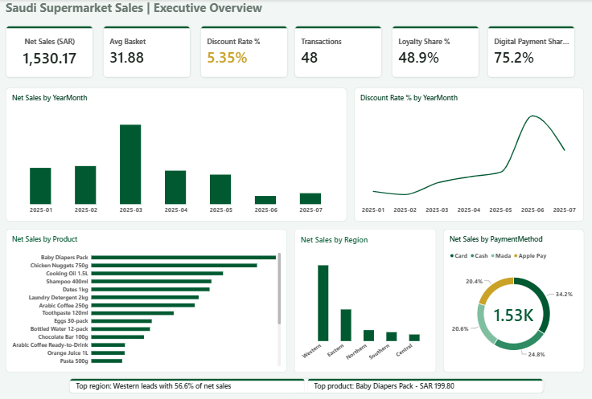
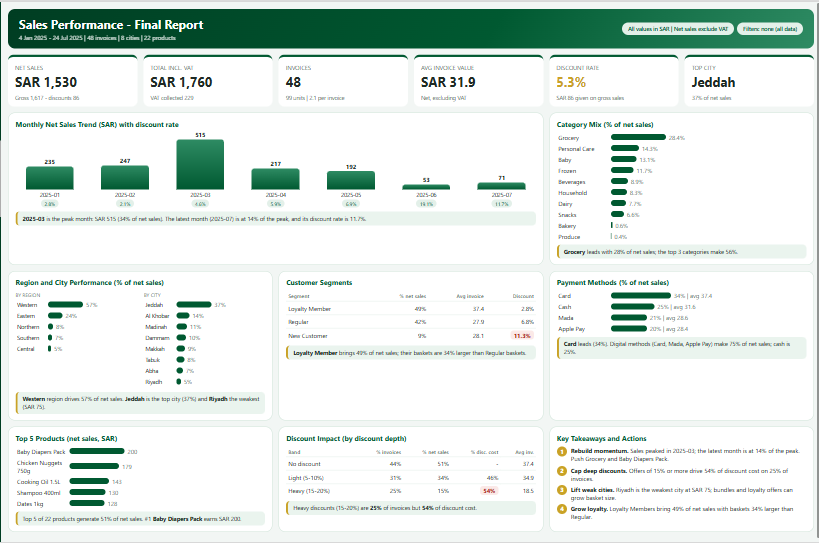

# Saudi Supermarket Sales: Power BI Dashboard

**English** | [العربية](README.ar.md)

**▶ [Live Dashboard](https://salehmsa.github.io/demos/saudi-supermarket-sales/)** — interactive web version (Arabic / English, dark / light), recalculated in the browser from the same dataset.

Executive Power BI dashboard on a sample of Saudi supermarket transactions (48 rows, Jan–Jul 2025, SAR). Two pages: an **Executive Overview** (native visuals) and an interactive **HTML Report** (DAX-generated, with written insights).

**Interactive HTML Report page** (DAX-generated, recalculates with the slicers):

## Key numbers

| KPI | Value |
|---|---|
| Net Sales | SAR 1,530.17 |
| Avg Basket | SAR 31.88 |
| Discount Rate | 5.35% (amber) |
| Transactions | 48 |
| Loyalty Share | 48.9% |
| Digital Payment Share | 75.2% |

The Western region drives 56.6% of net sales. Discounts peaked in June at 19.1% of gross sales.

## What's inside

- **6 KPI cards** with status colors. Discount Rate is green up to 5%, amber from 5% to 8%, red above 8%, driven by one DAX measure.
- **32 DAX measures** grouped in display folders (Sales, Basket, Discounts, Time, Customers, Products, Formatting).
- **5 charts:** net sales by month, discount rate by month, net sales by product, by region and by payment method.
- **Full cross-filtering** across Region, City, Category and Customer Segment slicers, and between charts.
- **Dynamic insight lines** (top region, top product) that change with every filter.
- **Custom JSON theme** applied across all visuals.
- **Interactive HTML Report page** built entirely with DAX measures (the HTML Content visual renders one measure, `Report HTML`). It has 6 KPI cards (including VAT and Top City), monthly trend with discount chips, category mix, region and city performance, customer segments, payment methods, top products, a discount-impact table by depth band, and four action recommendations. Every card carries a written insight that recalculates with the slicers, which are synced across both pages.

## Repository layout

| Folder | Content |
|---|---|
| `dax/` | Core measures (`Saudi_Supermarket_Measures.dax`) and the 13 HTML-report measures (`Saudi_Supermarket_HTML_Blocks.dax`) |
| `theme/` | Power BI theme (JSON) |
| `data/` | Sample dataset (xlsx) |
| `docs/` | Dashboard images (both pages), insights spec, LinkedIn carousel (PDF) |

## Data model

- `Saudi_Supermarket_Sales`: fact table, one row per transaction (48 rows).
- `Dim Date`: date table, related to the fact table on `Date` (many-to-one).

## How to rebuild it

1. Open Power BI Desktop and load `data/Saudi_Supermarket_Sales_SalesData.xlsx` (sheet `SalesData`).
2. Create `Dim Date` (CALENDAR over the data range) and relate it to the fact table on `Date`.
3. Open **DAX query view**, paste the contents of `dax/Saudi_Supermarket_Measures.dax`, and click **Update model with changes**.
4. Import the theme: **View → Themes → Browse for themes** and select `theme/Saudi_Supermarket_Theme_v2.json`.
5. Build the visuals: 6 cards (`Net Sales`, `Avg Basket`, `Discount Rate %`, `Transactions`, `Loyalty Share %`, `Digital Payment Share %`) and the five charts, then add the four slicers.
6. For the HTML Report page: install the **HTML Content** custom visual, run `dax/Saudi_Supermarket_HTML_Blocks.dax` in DAX query view (**Update model with changes**), and put the `Report HTML` measure in the visual's Values well. Copy the four slicers to the page with **Sync slicers** on.
7. For the Discount Rate card: **Format → Callout value → Color → fx → Field value → `Discount Status Color`**.

## Business questions the dashboard answers

- Which region and products drive net sales?
- Is the discount level healthy, and when did it spike?
- How big is the loyalty segment, and how do its baskets compare?
- Which payment methods dominate?
- How much of the discount cost comes from deep discounts, and what should the business do about it?

## Notes on the HTML page

The HTML Content visual is sandboxed, so clicking inside it cannot filter other visuals. Interactivity comes from the synced slicers (every number and insight recalculates) and hover effects.

## Limitations

The dataset is a small sample (48 transactions), so this is an exercise in modelling and dashboard design, not a market conclusion.

